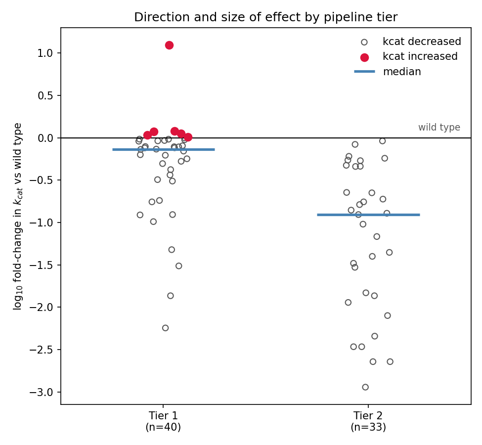
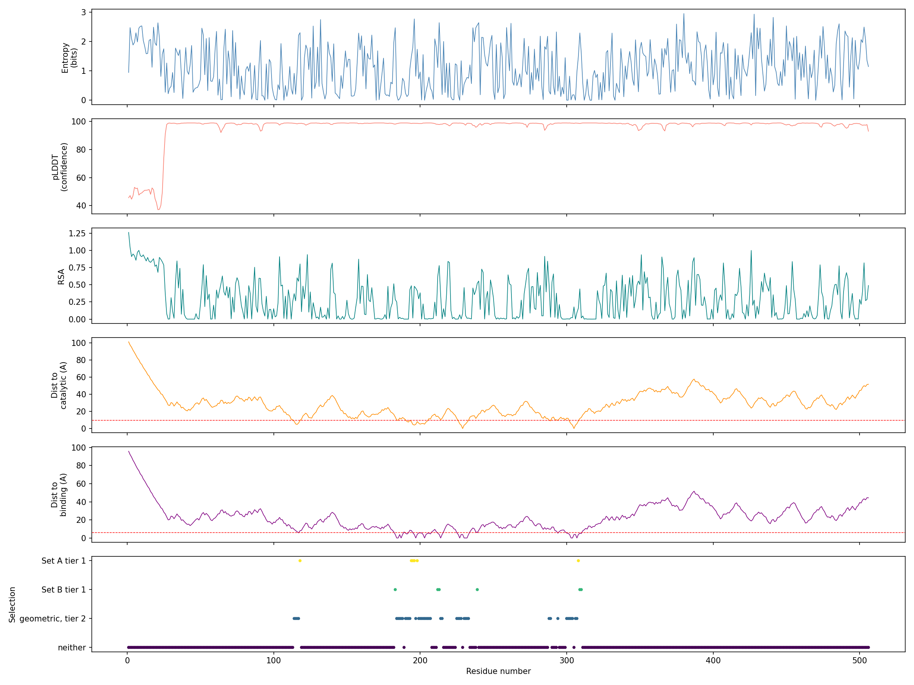
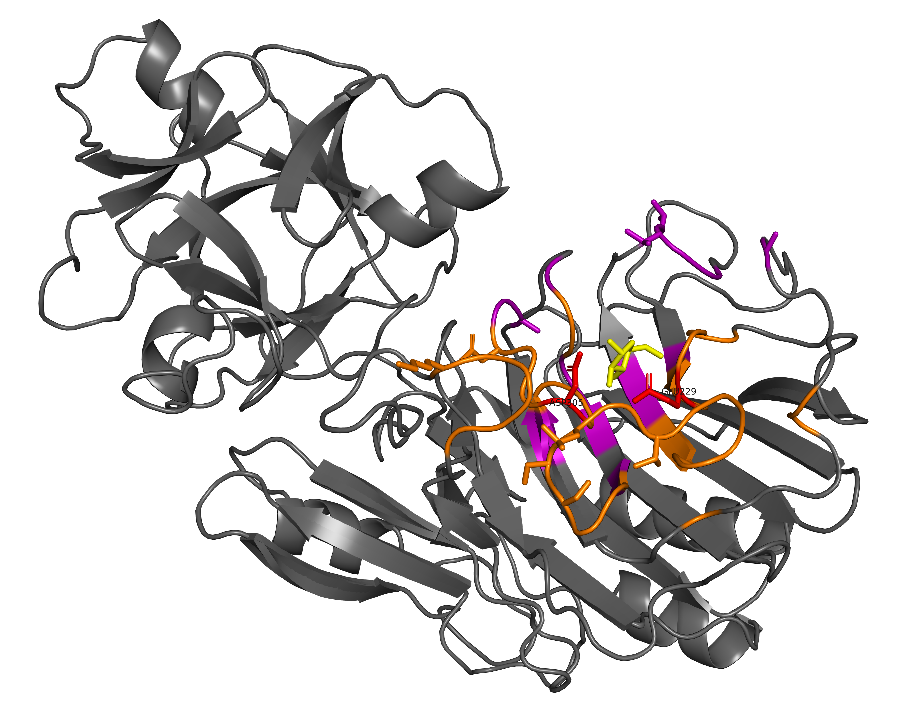
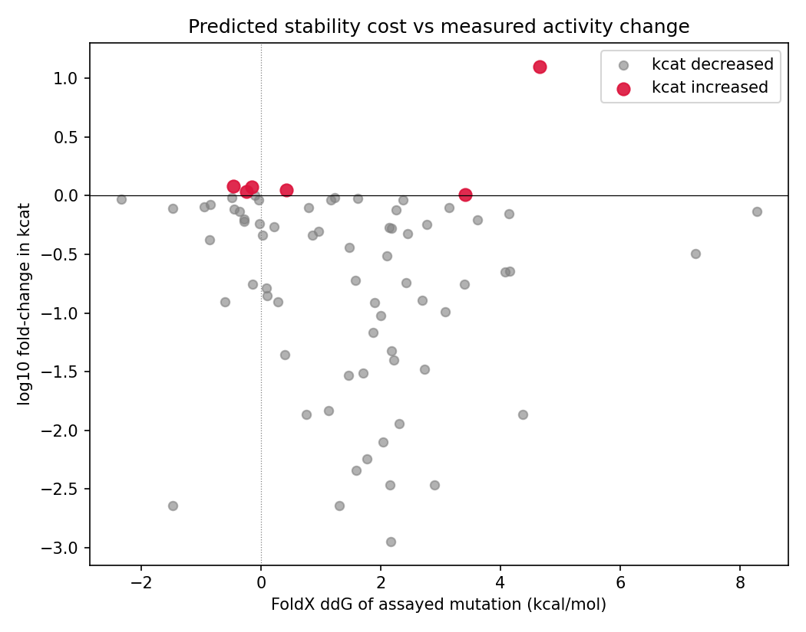

# Rational Enzyme Engineering Pipeline

A reproducible workflow that takes an enzyme structure and returns a ranked, screenable set of mutation targets for improving catalytic activity.

**Input:** a structure, a chain, and the catalytic residues.

**Output:** candidate positions grouped by mechanistic hypothesis, ranked by evolutionary evidence, with structural and biophysical context for each position.

**Key results**
- Ranking correlates with measured k<sub>cat</sub> (Spearman ρ = 0.56, n = 73 mutants), above the best of the 54 Rosetta structural features computed for the same system by Carlin et al. 2016 (|SRC| = 0.42).
- All 6 activity-improving mutants in that dataset fall in tier 1, the pipeline's priority tier (p = 0.023).
- Applied to an uncharacterised GH54 α-L-arabinofuranosidase from my [CAZyme mining project](https://github.com/Teaholicus/fungal-multidomain-cazyme-mining): 12 tier 1 positions, 84 candidate variants.

Switching to a new enzyme is done by editing one line of configuration.

---

## Why this exists

Site-saturation mutagenesis across hundreds of enzyme residues is not feasible. Narrowing to a few dozen positions is. The problem is choosing which ones.

This pipeline selects those positions from three kinds of evidence: where a residue sits relative to the catalytic machinery and substrate, how much evolution has varied it, and what a force field predicts about its stability. It also keeps every intermediate value traceable to the method that produced it.

---

## How it works

| Step | Does | Key output |
|---|---|---|
| `01` | Fetch structure (RCSB or AlphaFold DB) + UniProt sequence; verify numbering | numbering check |
| `02` | MMseqs2 search vs UniRef90, filter, cluster at 90% | homolog set |
| `03` | MAFFT alignment; Henikoff-weighted Shannon entropy | `cons_*` per residue |
| `04` | FoldX RepairPDB + PositionScan | ΔΔG for all 20 substitutions |
| `05` | B-factor or pLDDT, distances, packing, disulfide detection | `struct_*` |
| `06` | FreeSASA: absolute and relative accessibility, burial class | `struct_sasa_*` |
| `07` | DSSP: secondary structure, φ/ψ, backbone strain flags | `struct_ss_*` |
| `08` | Merge, define candidate sets, rank, export library spec | ranked candidates |

### Candidate sets

The two sets encode two different mechanistic hypotheses:

- **Set A, catalytic-adjacent.** Within 10 Å of a catalytic residue, excluding the catalytic residues themselves. Rationale: repositioning the acid/base machinery without altering the chemistry.
- **Set B, substrate-binding cleft.** Within 6 Å of a binding-site residue, excluding anything already in Set A. Rationale: retuning substrate affinity and positioning.

Binding-site residues are derived **geometrically from ligand contacts**, not curated from the literature, so the approach transfers to uncharacterised targets. When the target itself has no ligand-bound structure, the ligand is transferred from a homologous co-crystal by structural superimposition (`util_transfer_ligand.py`). The pose carried over is one that was experimentally observed in the homolog rather than a docked prediction, and the quality of the transform is reported as an RMSD.

### Priority tiers

Each candidate position is assigned a tier from the alignment alone:

- **Tier 1:** the wild-type residue is *not* dominant among homologs, meaning it occupies less than 70% of that alignment column. Evolution has already demonstrated that the position tolerates change.
- **Tier 2:** the wild-type residue is dominant, at 70% or above. Change here is more likely to be disruptive.

Tier 1 is the screening priority. Tier 2 positions are kept in the output rather than discarded, because they are the right targets for a different question, for example reverting a position toward the family consensus.

### What the candidate variants are

The deliverable is a **library specification**, so positions come first and substitutions second. For each position the pipeline lists which of the 20 substitutions fall within the reported stability range, along with how often each residue appears at that column among homologs. Those position-substitution pairs are the candidate variants, and they exist to answer the practical question that follows position selection: at this position, which residues are worth putting in the library, and which degenerate codon or small primer set covers them.

### Bookkeeping

Every intermediate table is written to disk. The merged master table keeps every residue and every column; selection happens in added boolean columns, never by dropping rows.

---

## Validation

Tested against **BglB**, a GH1 β-glucosidase, using the dataset of Carlin et al. 2016, which measured k<sub>cat</sub> and K<sub>M</sub> for 100 purified single mutants. The pipeline was run blind to those results; the comparison came afterwards.

Throughout this section, measured kinetics and the Rosetta feature benchmark are from Carlin et al. 2016. Ranks, tiers, entropies and correlations are computed by this pipeline.

**Ranking correlates with measured kinetics.**
The best single pipeline feature reaches Spearman ρ = 0.559 against log₁₀ relative k<sub>cat</sub> (n = 73 mutants with measurable activity). For reference, Carlin et al. computed 54 Rosetta structural features for this same system, and their best single predictor reached |SRC| = 0.421. The four strongest features in this pipeline are all conservation-derived, not structural.

**The priority tier separates improvement from breakage.**
Of the 6 mutants that Carlin et al. measured as increasing k<sub>cat</sub> above wild type, all 6 fall in tier 1 as assigned by this pipeline. Chance expectation is 3.3, hypergeometric *p* = 0.023. Tier 2 mutations produced larger effects on average, but almost entirely destructive ones: the most damaging mutations in the dataset, down to 0.1% of wild-type activity, are overwhelmingly tier 2. Conserved positions are where the enzyme breaks, variable positions are where it improves.



*Measured |log₁₀ fold-change in k<sub>cat</sub>| for 73 BglB mutants (Carlin et al. 2016), split by the tier this pipeline assigned before seeing any kinetics. Tier 2, the conserved positions, carries the large effects; all six activity **improvements** are in tier 1.*

**Known functional residues are recovered without being supplied.**
Y298 orients the catalytic nucleophile through a hydrogen bond. It was not given to the pipeline as a catalytic residue, and came back with entropy 0.040 and a wild-type residue conserved at 99.8%, the same signal as the catalytic glutamates themselves.

**The paper's key position is ranked highly.**
R243 in UniProt numbering, R240 in the numbering used by Carlin et al., carries the roughly 12-fold k<sub>cat</sub> improvement they report. This pipeline placed it 6th of 52 binding-cleft positions, in tier 1, from structure and sequence alone. Its hydrogen-bond partner E225 (E222 in their numbering) ranked 5th.

**Conservation agrees with independent alignments.**
Carlin et al. report per-position conservation from 1,554 GH1 sequences in Pfam. This pipeline derived conservation independently from 612 UniRef90 sequences, and the two agree at ρ = 0.668. Separately, on a different protein, this pipeline's conservation was cross-checked against the ConSurf server: ρ = 0.84 on conservation grades, r = 0.93 on per-position amino-acid composition.

Full analysis, including every number above: [`validation/bglb_kinetic_validation.ipynb`](validation/bglb_kinetic_validation.ipynb).

---

## Predictions for an uncharacterised target

**AbfB from *Aspergillus clavatus*** (UniProt A1CGD1), a GH54 α-L-arabinofuranosidase with a CBM42 targeting module, selected from my [fungal CAZyme mining project](https://github.com/Teaholicus/fungal-multidomain-cazyme-mining). No published engineering work, and no experimental structure was available. 

**No crystal structure available, therefore:** an AlphaFold model was used (506 residues, median pLDDT 98.7; the 24 low-confidence residues are the signal peptide and are excluded). In a predicted model the B-factor column holds pLDDT, where a high value means *confident* rather than *mobile*. The pipeline detects the model type and relabels the column accordingly, since reading it the usual way inverts the meaning.

**The ligand** arabinose was transferred from the *A. luchuensis* homolog 1WD4 (76.1% identity). Global superimposition across both domains gave 3.88 Å RMSD, which reflects a hinge difference rather than a fold difference, while a local refit on the 50 Cα pairs within 12 Å of the ligand gave 0.19 Å. 1WD4 holds three arabinose copies; the one in the catalytic pocket was selected and the two on the CBM42 module excluded. The superimposed model was used only to define Set B, all other features come from the AlphaFold model itself.

That selection is independently corroborated: UniProt separately annotates substrate-binding residues at 227/230/304 (pocket) and 424/426/427/443/471/476/496 (CBM42). All three pocket positions appear in the geometric contact list; none of the CBM42 positions do.

**Result: 12 tier 1 positions, 84 candidate variants.** Six tier 1 positions are in Set A (of 38 geometric) and six in Set B (of 17 geometric). They fall into three contiguous stretches, 194/195/196/198, 212/213 and 308/309/310, flanking the conserved pocket. Every binding-site residue itself is tier 2, at 88% conservation or above, so the first shell is evolutionarily locked and the available space is the second shell that positions it. That is the same mechanism class as the R243 result in BglB.



*All 506 residues. The pLDDT cliff at around residue 25 marks the signal peptide; candidates are confined to the 110 - 310 range, with nothing in the CBM42 module past 350. Tier 1 positions appear as isolated points flanking dense tier 2 blocks.*



*The same selection on the AlphaFold model, with the transferred arabinose in yellow. Catalytic residues are red, Set A orange, Set B purple, and the rest of the chain grey. Side chains are drawn for tier 1 positions only. The CBM42 module, upper left, carries no candidates.*

The highest-ranked candidate is **L196** (Set A rank 1): entropy 2.78, exposed loop, 4.07 Å from the catalytic residues, and arginine is *more* common at that column among homologs (31%) than the wild-type leucine (22%). FoldX predicts L196R to be mildly stabilising, at −0.94 kcal/mol.

**Two caveats specific to this target.** The alignment is thinner than BglB's, 199 homologs against 612, so conservation calls are correspondingly less certain. And 352 of 384 candidate substitutions are flagged "novel to nature", but in a conserved pocket sampled by few homologs that mostly reflects what the alignment has not seen rather than a biophysical opportunity.

Architecture shows up clearly in the numbers. BglB's Set A is 34 buried / 6 intermediate / 0 exposed, an active site at the bottom of a TIM barrel. A1CGD1's is 18 / 6 / 14, a shallow surface pocket. Same pipeline, same parameters.

---

## Limitations

**It ranks positions, not substitutions.** This is the clearest limitation, and the Carlin et al., 2016 measurements show it plainly. At position 243: R→A gives 12.5-fold activity, R→K gives 1.02-fold, R→D gives 0.32-fold. At position 225: E→Q retains 76% of activity, E→Y retains 1.4%. Same position, roughly 40-fold spread. The pipeline identifies positions worth screening; it cannot say which substitution to make. That is what the screen is for, and it is why the deliverable is a library specification.

**It does not model epistasis.** Conservation is evaluated one alignment column at a time, so a residue that is rare across the family but required *in this protein* because of its specific surroundings will be scored as tolerant. Coupling analyses such as DCA or EVcouplings, or protein language models, would address this.

**Conservation quality depends on the alignment.** Early runs included homologs down to 25% identity, which pulled in the wider enzyme family rather than close orthologs and inflated apparent variability. At one position a fully conserved cysteine appeared 78% variable. Raising the threshold to 40% fixed it. A target with few available homologs will produce a weaker signal, and the pipeline flags positions with thin alignment coverage rather than hiding them.

**ΔΔG is used for ranking, not filtering.** In the BglB comparison, predicted stability change correlated only weakly with measured activity: ρ = −0.242 signed, and ρ = 0.289 against effect magnitude. More pointedly, the best mutant in the dataset, R243A at 12.5-fold k<sub>cat</sub>, was predicted to be among the *more* destabilising substitutions at its position, at +4.66 kcal/mol. An earlier version of this pipeline used a 2 kcal/mol ceiling as a hard filter, which removed it.



*Each point is one BglB mutant, with k<sub>cat</sub> from Carlin et al. 2016 and ΔΔG from this pipeline. The best mutant in the dataset, top right at 12.5-fold k<sub>cat</sub>, is among the most destabilising substitutions predicted at its position.*

This is one enzyme, one substrate and 73 measured mutants, so it is not a general claim about ΔΔG prediction. It is consistent with the stability-function trade-off described in the literature, where activity-improving changes at functional positions often carry a real stability cost. The practical conclusion drawn here is narrow: ΔΔG is reported and used for ranking within a position, never to exclude candidates. For a project targeting thermostability rather than activity, the appropriate use would be different.

FoldX also returns very high ΔΔG at glycine positions and at disulfide-bonded cysteines, which is expected, since glycine accesses backbone conformations other residues cannot and breaking a disulfide is genuinely costly. Because ΔΔG only ranks, these positions are not excluded; they are reported with the flag that explains the value.

**One flag had to be narrowed.** A flag for "stabilising substitution near a catalytic site", intended as a possible signal of relieved functional strain, turned out to track solvent exposure instead. Within a single structure, substitutions below −0.5 kcal/mol account for about 6% at buried positions (median ΔΔG about 4.0) against 16 to 20% at exposed ones (median about 0.3): an exposed loop residue has no packing to disrupt, so substitutions are near-neutral and ordinary scatter crosses the threshold. The flag is now restricted to buried and intermediate positions, where it means what it was intended to mean. A plausible alternative explanation, that predicted structures being idealised inflate apparent stabilisation, was tested across all tested targets and was not supported (8.9% against 7.3%; the ΔΔG distributions essentially superimpose).

---

## Running order

```bash
# one-time: build the local homolog database (~20 GB download)
bash tools/setup_uniref90.sh /absolute/path/to/db_dir

# select a target
#   config/active.yaml -> active_protein: "2JIE_A"

python workflow/01_acquire_protein.py
python workflow/02_search_homologs.py        # needs mmseqs2
python workflow/03_conservation_analysis.py  # needs mafft
python workflow/04_foldx_ddg.py              # needs a FoldX licence; slow
python workflow/05_bfactor_and_geometry.py
python workflow/06_solvent_accessibility.py
python workflow/07_secondary_structure.py    # needs mkdssp
# then: workflow/08_merge_and_analysis.ipynb
```

Adding a target means one new file in `config/` and one edited line in `config/active.yaml`. Results are namespaced per protein, so targets never overwrite each other.

Full command reference, including the config-preparation utilities and which steps need WSL: [`RUNNING.md`](RUNNING.md).

External tools: MMseqs2, MAFFT, DSSP, FreeSASA, and FoldX (academic licence required, not redistributable). Everything else is pip-installable.

---

## Repository layout

```
config/             active.yaml (target selector) + base.yaml + one file per target
workflow/           numbered pipeline steps, shared utilities, config-prep tools
data/sequences/     query and homolog sequences, per protein
data/structures/    downloaded structures, per protein
validation/         BglB kinetic validation, ConSurf cross-check
validation/data/    parsed supplementary tables from Carlin et al. 2016
tools/              database setup script; expected location of a local FoldX install
results/<TARGET>/   all intermediate and final tables, per protein
```

---
## A note on authorship

The pipeline design, the choice of methods, the validation strategy and the interpretation of the results are mine. An LLM was used as a coding and writing assistant throughout, most visibly in code annotation and other documentation.

---
## References

**Validation dataset**
Carlin DA, Caster RW, Wang X, et al. (2016) Kinetic characterization of 100 glycoside hydrolase mutants enables the discovery of structural features correlated with kinetic constants. *PLoS ONE* 11(1): e0147596. [doi:10.1371/journal.pone.0147596](https://doi.org/10.1371/journal.pone.0147596)

**Structures**
BglB: PDB [2JIE](https://www.rcsb.org/structure/2JIE). Thiocellobiose complex used for binding-site contacts: PDB [2O9R](https://www.rcsb.org/structure/2O9R). Arabinose donor for the A1CGD1 ligand transfer: PDB [1WD4](https://www.rcsb.org/structure/1WD4). A1CGD1 model: [AlphaFold DB](https://alphafold.ebi.ac.uk/entry/A1CGD1).

**Methods and tools**
- Henikoff S, Henikoff JG (1994) Position-based sequence weights. *J Mol Biol* 243:574-578. [doi:10.1016/0022-2836(94)90032-9](https://doi.org/10.1016/0022-2836(94)90032-9)
- Steinegger M, Söding J (2017) MMseqs2. *Nat Biotechnol* 35:1026-1028. [doi:10.1038/nbt.3988](https://doi.org/10.1038/nbt.3988)
- Katoh K, Standley DM (2013) MAFFT v7. *Mol Biol Evol* 30:772-780. [doi:10.1093/molbev/mst010](https://doi.org/10.1093/molbev/mst010)
- Schymkowitz J, Borg J, Stricher F, et al. (2005) The FoldX web server. *Nucleic Acids Res* 33:W382-W388. [doi:10.1093/nar/gki387](https://doi.org/10.1093/nar/gki387)
- Kabsch W, Sander C (1983) DSSP. *Biopolymers* 22:2577-2637. [doi:10.1002/bip.360221211](https://doi.org/10.1002/bip.360221211)
- Mitternacht S (2016) FreeSASA. *F1000Research* 5:189. [doi:10.12688/f1000research.7931.1](https://doi.org/10.12688/f1000research.7931.1)
- Jumper J, Evans R, Pritzel A, et al. (2021) AlphaFold. *Nature* 596:583-589. [doi:10.1038/s41586-021-03819-2](https://doi.org/10.1038/s41586-021-03819-2)
- Ashkenazy H, Abadi S, Martz E, et al. (2016) ConSurf 2016. *Nucleic Acids Res* 44:W344-W350. [doi:10.1093/nar/gkw408](https://doi.org/10.1093/nar/gkw408)
- Suzek BE, Wang Y, Huang H, et al. (2015) UniRef clusters. *Bioinformatics* 31:926-932. [doi:10.1093/bioinformatics/btu739](https://doi.org/10.1093/bioinformatics/btu739)
- Cock PJA, Antao T, Chang JT, et al. (2009) Biopython. *Bioinformatics* 25:1422-1423. [doi:10.1093/bioinformatics/btp163](https://doi.org/10.1093/bioinformatics/btp163)

**Stability-function trade-off**
Tokuriki N, Stricher F, Serrano L, Tawfik DS (2008) How protein stability and new functions trade off. *PLoS Comput Biol* 4(2): e1000002. [doi:10.1371/journal.pcbi.1000002](https://doi.org/10.1371/journal.pcbi.1000002)
